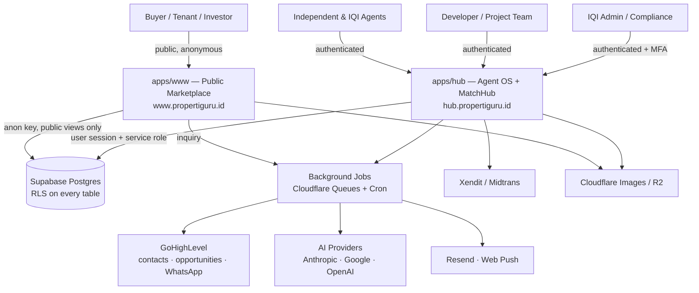
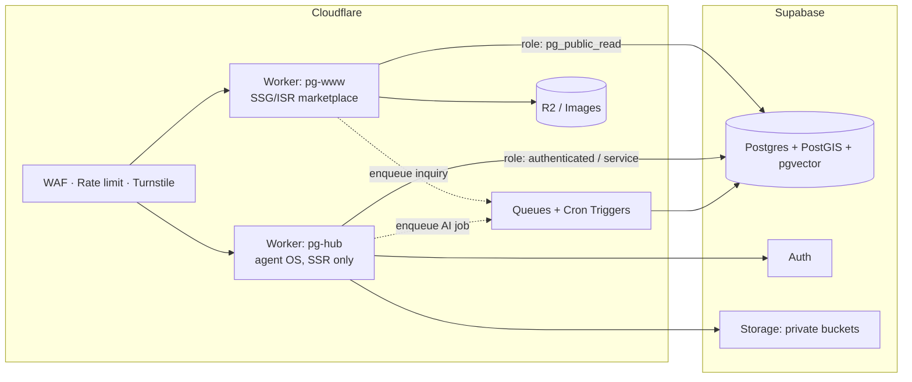
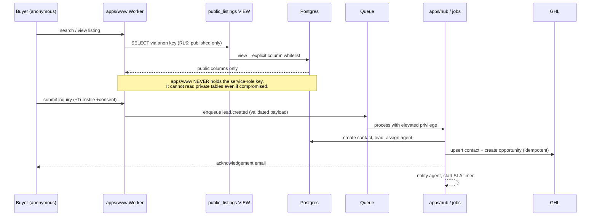
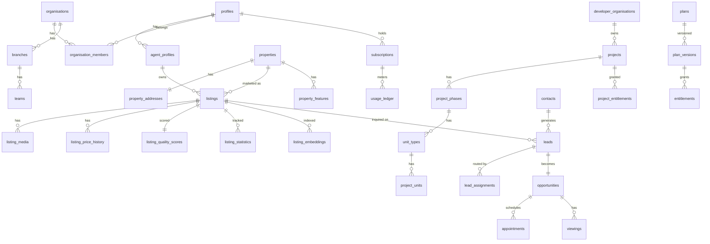

# PropertiGuru Next — Stage A: Audit, Architecture & Implementation Plan

*Produced 4 Aug 2026 per master prompt §1 (Mandatory Execution Rule) and §29 (Stage A Deliverables). v1.0.*

**No production code was written. No files, databases, migrations or configurations were deleted or modified.** All database access during this audit was read-only (`SELECT` on catalogue tables and row counts).

---

# A. Executive Technical Summary

## A.1 Current system condition

| Asset | Reality found | Condition |
|---|---|---|
| `hub.propertiguru.id` | **IQI AG MatchHub, live in production** on Cloudflare Workers. Next.js 16.2.10 + React 19 + TypeScript strict + Supabase + next-intl. 10,807 LOC, 37 routes, 46 tables, 88 indexes, 20 `SECURITY DEFINER` functions, 38 RLS tests, GitHub Actions CI. `tsc --noEmit` **clean**. i18n complete: 1,050 keys × EN/MS/**ID**. | **Healthy. Production-grade. Reuse.** |
| `www.propertiguru.id` | **Does not exist.** DNS `NXDOMAIN`. Apex `propertiguru.id` does not serve either. | **Greenfield.** |
| Existing database | Supabase project `jtruwmwinymflkrvuuwd` (ap-southeast-1). 46 tables, **RLS enabled on 100% of them**, ~60 policies. Real usage: 9 profiles, 12 requests, 9 submissions, 6 presentations, 3 commission agreements, 64 audit records. | **Sound foundation. Extend, don't replace.** |
| MatchHub application | Feature-complete co-broke platform: requests → password-gated supply links → submissions → client presentations → offers/viewings → versioned dual-accepted commission agreements → disclosures → violation reports → admin console → audit viewer. | **This *is* Module 3. Already built.** |
| GHL integration | **No TypeScript client exists.** Two working reference implementations: PHP `GHLClient.php` (marketing4u, v2 LeadConnector, tag + stage writeback, `GHL_LIVE` dry-run switch) and JS in `ag-warriors-superapp/worker/src/index.js` (tag, pipeline stage cache, pending-writeback queue). | **Patterns proven, code must be ported to TS.** |
| Payments | None anywhere. | **Greenfield.** |
| AI | None in the codebase. | **Greenfield.** |

## A.2 Recommended architecture, in one paragraph

Keep the Supabase project and the entire identity / verification / consent / audit / brand / country / notification foundation that already exists and is RLS-tested. Move the MatchHub application into a monorepo as `apps/hub`, and build the public marketplace as a **second, separately deployed Next.js application** (`apps/www`) against the **same** database — but connecting through a **restricted read path that never holds the service-role key** and reads only from purpose-built public views. Shared logic (database types, brand config, i18n, projections, GHL adapter, AI adapter) lives in `packages/*`. Two Workers, two domains, one database, one migration history.

## A.3 Reuse versus rebuild — the recommendation

**Reuse the foundation. Build the marketplace new. Do not rebuild MatchHub.**

Reusing is worth roughly 8–10 weeks of engineering, and more importantly it preserves security work that was learned the hard way. The existing repo contains four separately-diagnosed fixes for Postgres `42P17` RLS infinite-recursion (migrations 00020, 00021, 00022 and the trigger-guard pattern), a hard-won rule that confidential columns must live in `*_private` companion tables because RLS cannot hide columns, and a documented `NextIntlClientProvider` leak that was serialising the entire message dictionary — including commission vocabulary — into every page's HTML. A rebuild re-earns all of that.

What must be built new: public marketplace surface, listing/property inventory model, geospatial + semantic search, developer portal, subscriptions & billing, AI service layer, GHL adapter, and the plan/entitlement engine.

## A.4 Primary risks (full register in §J)

1. **Brand/IP — the highest-severity item.** PropertyGuru Group owns Rumah123, the incumbent Indonesian portal. "PropertiGuru" is one transposed vowel from the parent brand of the direct competitor, and it is **already embedded in production**: the Cloudflare custom domain, the Resend-verified sending domain (`noreply@propertiguru.id`), Supabase Auth URL configuration, and `wrangler.jsonc` vars. A forced rename after public launch is not a code change — it is a DNS, email-reputation, auth-callback and SEO migration. Decide the public brand **before** Phase 1 ships publicly.
2. **Shared-database confidentiality.** The public marketplace will query the same Postgres instance that holds MatchHub minimum prices, commission splits and source-agent chains. A single careless public query is a catastrophic disclosure.
3. **Cold-start inventory.** There are 9 property submissions in the database. A marketplace with no listings converts nobody. This is the largest *product* risk and it is not solved by code.
4. **Missing extensions.** Live database has `pgcrypto`, `uuid-ossp`, `pg_stat_statements`, `supabase_vault`. It has **no PostGIS and no pgvector** — both are required by §16 and §12.
5. Metered third-party cost (AI, WhatsApp, image processing) with no meter built yet.

## A.5 Recommended MVP

Not the nine modules in §10. The MVP is §28's acceptance journey and nothing else:

> Agent registers → verified (IQI agents get complimentary Premium) → creates a listing with AI assistance → moderation → published & searchable → buyer inquires → lead created & assigned → contact + opportunity sync to GHL → acknowledgement + agent notification → viewing proposed and booked → pipeline progresses → everything audited, permission-scoped and quota-enforced.

Everything in §10 that is not on that line is Phase 2 or later. MatchHub already exists and simply gets linked in — it does not need rebuilding to satisfy the MVP.

---

# B. Repository Audit

## B.1 Existing stack (`kamal\ag-matchhub\app`)

| Layer | Technology | Version | Assessment |
|---|---|---|---|
| Framework | Next.js App Router | 16.2.10 | Current. Note: `build` script is `next build --webpack` — OpenNext does not support Turbopack. |
| UI | React | 19.2.4 | Current. |
| Language | TypeScript strict | ^5 | `tsc --noEmit` passes clean. |
| Styling | Tailwind CSS | v4 (`@tailwindcss/postcss`) | Design tokens, light/dark. shadcn/ui **not** installed despite the Phase 0 plan naming it — components are hand-rolled in `src/components/ui`. |
| Data | `@supabase/supabase-js` ^2.110, `@supabase/ssr` ^0.12 | Current. |
| Validation | Zod ^4.4 + react-hook-form ^7.82 | Good. |
| i18n | next-intl ^4.13 | EN/MS/ID, 1,050 keys each, zero drift. |
| Notifications | `web-push` ^3.6 + Resend via REST `fetch` | Push confirmed working on device; email verified sender live. |
| Tests | Vitest ^4.1 — 38 RLS tests, 6 files | Security-focused. **No component, E2E or unit-logic tests.** |
| Deploy | `@opennextjs/cloudflare` ^1.20 + wrangler ^4.112 | Live. |

## B.2 Folder structure

```
apps/hub (today: ag-matchhub/app)
├── src/app/
│   ├── (admin)/admin/*     11 admin routes (agents, requests, reports, legal, countries, audit)
│   ├── (agent)/*           12 agent routes (dashboard, requests, submissions, profile, notifications)
│   ├── (auth)/*            5 auth routes
│   ├── r/[token]/*         supply-agent gated request view + submit
│   ├── p/[token]/*         client presentation + compare + XLSX export
│   └── wanted/             public reverse-portal board
├── src/lib/
│   ├── projections/        ← the confidentiality mechanism (client-safe DTO whitelists)
│   ├── authz/  agents/  submissions/  supabase/  validation/
│   ├── audit.ts  consents.ts  contact-detection.ts  email.ts  webpush.ts
│   ├── notifications.ts  request-links.ts  xlsx-lite.ts
├── supabase/migrations/    28 sequential SQL migrations
├── tests/rls/              6 files, 38 assertions
├── messages/{en,ms,id}.json
└── wrangler.jsonc          custom domain hub.propertiguru.id
```

Structure is clean and domain-oriented. No god-components; no unstructured `utils/` dumping ground.

## B.3 Package health

Dependency surface is small (12 runtime deps) and current. `pg` is a devDependency used only by the migration runner. `@swc/helpers` is pinned as a direct devDependency to resolve a lockfile conflict — keep it. No known-abandoned packages. Nothing pulls a heavyweight UI kit.

## B.4 Build & test status

- `npx tsc --noEmit` → **exit 0, zero errors** (verified this session).
- CI pipeline: lint → tsc → test → build → secret-scan. Reported green.
- RLS suite: 38 tests, `skipIf(!hasEnv)` so CI without secrets skips them — meaning **CI does not actually prove RLS in the pipeline**; the suite only runs locally where `.env.local` credentials exist. This is a gap.

## B.5 Security concerns found

| # | Finding | Severity | Note |
|---|---|---|---|
| S1 | `.env.local` and `.env.production` are on disk; `.env.production` is committed (documented as NEXT_PUBLIC-only, no secrets). Anon/publishable key and Supabase URL are in `wrangler.jsonc` — correct, those are public by design. | Info | Verified no service-role key in committed files. |
| S2 | DB password was shared in chat during setup and **has not been rotated** (carried as pending since 18 Jul). | **High** | Rotate before the marketplace adds a second consumer of this database. |
| S3 | Test accounts with known passwords exist in production auth (`kamal.auction+mhtest1/2/admin@gmail.com`, several `+agent*`). Kamal's own Super Admin temp password was issued in chat. | **High** | Rotate/disable before public launch. |
| S4 | RLS tests do not run in CI (no secrets) — the strongest safety net is not enforced on merge. | Medium | Add a CI-only Supabase branch/project with seeded test users. |
| S5 | No Turnstile in use yet despite `NEXT_PUBLIC_TURNSTILE_SITE_KEY` being in `.env.example`. Public forms (register, `/r` password gate, `/wanted`) rely on custom rate limiting only. | Medium | Marketplace inquiry forms will be a spam magnet — wire Turnstile in Phase 1. |
| S6 | Client presentation pages (`/p/[token]`) have no Supabase session by design, and writes go through the service client after an HMAC cookie gate. Correct pattern, but it means **the hub Worker holds the service-role key** and serves public-ish traffic. | Medium | Do not repeat this in `apps/www`. See §D.4. |
| S7 | `web-push` on the Workers runtime under `nodejs_compat` is wrapped in try/catch and unverified on the production path. | Low | Local send confirmed 201; production admin-push path unconfirmed. |

## B.6 Technical debt

- **RLS recursion is a recurring trap.** Four separate incidents. The rule is now documented — *a policy subquery must never reach a table that can lead back to the policy's own table; use `SECURITY DEFINER` functions or `BEFORE UPDATE` triggers* — and must be a code-review gate item, not tribal knowledge.
- **PostgREST FK-embed ambiguity.** Adding a second FK from table X to `profiles` breaks every existing `profiles(...)` embed on X. Fixed in 00028 by repointing audit/actor columns at `auth.users`. Same rule applies to every new table.
- **Test coverage is one-dimensional** — RLS only. No unit tests on commission maths, no E2E.
- **`shadcn/ui` in the plan, hand-rolled components in reality.** Decide deliberately; a marketplace needs a much larger component surface.
- Design-system tokens exist but there is no documented component inventory.
- **28 migrations with no squash point** and no staging database — every migration has only ever been applied to production.

## B.7 Directly reusable components

| Asset | Reuse for PropertiGuru Next |
|---|---|
| Migration 00001 identity foundation: `profiles`, `users_private`, `roles`, `user_roles`, `has_role()`, `is_platform_admin()`, auto-provision trigger | Whole-platform identity. **Reuse as-is.** |
| `agent_profiles`, `agent_verifications`, `agencies` + storage buckets with owner-folder RLS | Agent onboarding & verification (§15). **Reuse, extend for IQI roster + developer reps.** |
| `declarations` / `declaration_versions` / `consent_records` + `lib/consents.ts` | §19 consent, marketing consent, PDP compliance. **Reuse.** |
| `audit_logs` + append-only `log_audit()` + `/admin/audit` viewer | §19 audit trail. **Reuse.** |
| `lib/projections/*` DTO whitelist pattern | The single most valuable pattern in the repo. **Reuse as the mandatory data-exit discipline.** |
| `brand_settings` / `brand_assets` + `config/brand.ts` | §4 brand abstraction — already correct. **Reuse.** |
| `countries` (70 seeded), `currencies`, `languages`, `/admin/countries` | §21 localisation + cross-border. **Reuse.** |
| `notifications` + `lib/notifications.ts` fan-out (in-app + web-push + Resend, per-recipient language) | §22 notification abstraction. **Reuse, add WhatsApp adapter.** |
| `lib/request-links.ts` (192-bit tokens, HMAC cookie, rate-limited gate) | Any tokenised public link. **Reuse.** |
| `lib/xlsx-lite.ts` (dependency-free XLSX writer) | Owner reports, developer price lists, admin exports. **Reuse.** |
| `components/forms/draft-guard.tsx` (localStorage draft mirror) | Long listing forms. **Reuse — this directly solves listing-form abandonment.** |
| `lib/agents/admin-create.ts` (admin creates account + acts on behalf) | Critical for Indonesia: agents are frequently not tech-literate. **Reuse and extend.** |
| Entire MatchHub domain (requests → submissions → presentations → commissions → disclosures) | §10 Module 3. **Already built.** |
| `lib/submissions/core.ts` shared row-builder | Pattern for keeping agent-path and admin-path writes identical. **Reuse.** |
| PWA: `manifest.ts`, `public/sw.js`, `PwaRegister`, VAPID push | §16 PWA-before-native. **Reuse.** |

## B.8 Missing documentation

`docs/permissions.md` is referenced by the Phase 0 plan but was never written. There is no ERD, no ADR log, no API contract document, and no runbook for the deploy gotchas (dev server corrupts `.next/dev/types`; `npm run build` deadlocks against a running dev server; OpenNext requires `--webpack`). These are currently only in conversation history and `CLAUDE.md`.

---

# C. Existing MatchHub Audit

## C.1 Current features (verified against live schema and routes)

Complete and in production: agent registration & document-based verification with admin queue; buyer/tenant requirement creation with human-readable IDs (`REQ-2026-000001`); admin approval issuing password-gated supply links with QR; supply-agent submission with media upload, source declaration and risk indicators; requesting-agent review board with shortlist/reject/request-info; client presentation links (separate token + access code) with client-safe projection, compare view and styled XLSX export; live-editable presentations with per-property client show/hide; in-platform messaging with contact-detail detection; offers with a state machine; viewing appointments; dual-accepted, immutably-versioned commission agreements with server-side split validation; legal disclosures with client-safe summaries; violation reports with reporter-invisible admin notes; admin audit viewer; public "Wanted" reverse-portal board; admin-on-behalf agent creation and property submission; multi-channel notifications.

## C.2 Database

46 tables, RLS on every one. 20 `SECURITY DEFINER` functions carry all privileged writes (`ra_review_submission`, `propose_commission_version`, `accept_commission_version`, `respond_to_offer`, `request_contact_release`, `log_audit`, `next_human_id`, `increment_presentation_views`, plus the recursion-avoidance helpers `is_collaborating_with`, `has_contact_release_with`, `is_submission_participant`, `owns_request`, `own_agent_status`, `admin_country_scope`). 88 indexes.

## C.3 Authentication

Supabase Auth (email + password, verification, reset). Session refresh and route protection in `src/middleware.ts` — note this was renamed from Next 16's `proxy.ts` because proxy is Node-only and Cloudflare needs edge. **Three trust zones**: authenticated agents/admins (RLS-scoped), tokenised client viewers (no DB identity at all), and public.

## C.4 Permissions & security posture

Defence in depth: RLS *and* server-side checks *and* an explicit projection whitelist on every response surface. Confidential fields are held in `*_private` companion tables because RLS filters rows, not columns. Adversarial tests confirm: requesting agents cannot read supply-agent minimum price or source chain; supply agents cannot read requesting-agent internal notes or competing submissions; reported users cannot see reports filed against them; client pages contain zero commission or supply-agent strings.

**This posture is materially better than most production systems and is the single strongest argument against rebuilding.**

## C.5 Reusable modules

See §B.7 — in practice, everything except the MatchHub-specific request/submission/presentation domain is platform-generic and reusable directly.

## C.6 Migration needs

**None structural.** The recommendation is not to migrate MatchHub's data or schema at all. The work is:

1. Move the application directory into the monorepo (`apps/hub`), unchanged, in one mechanical commit. Tag the pre-move state in the existing GitHub repo so the move is reversible.
2. Transfer ownership of `supabase/migrations` to the monorepo root so there is exactly one migration history for one database.
3. Rename generic tables only where the marketplace needs a broader concept — specifically, `property_submissions` is a *co-broke submission*, not a *marketplace listing*. These are different entities and both must exist. Do not overload one for the other.

## C.7 Integration recommendation

MatchHub becomes the **Premium collaboration module** of the agent operating system, reachable from the agent dashboard, with two new bridges:

- **Listing → Submission**: an agent with a published marketplace listing can submit it to an open MatchHub requirement in one click (pre-filling from the listing, then applying MatchHub's stricter confidentiality model).
- **Requirement → Buyer lead**: the Wanted board and MatchHub requirements become a demand-side signal feeding the marketplace's matching engine.

Access is gated by entitlement (`matchhub.access`), which Premium and verified-IQI agents hold. No code fork.

---

# D. Proposed Architecture

## D.1 System context



## D.2 Container view



## D.3 Module boundaries

Nine bounded contexts, each owning its tables and exposing a service interface. No module reaches into another's tables directly.

| Module | Owns | Depends on |
|---|---|---|
| `identity` | profiles, roles, agents, agencies, verification | — |
| `catalogue` | properties, listings, media, projects, units | identity |
| `discovery` | search, ranking, saved searches, favourites | catalogue |
| `crm` | contacts, leads, opportunities, tasks, viewings | identity, catalogue |
| `matchhub` | requirements, submissions, presentations, commissions | identity, catalogue |
| `developer` | developer orgs, projects, inventory, accreditation | identity, catalogue |
| `billing` | plans, entitlements, subscriptions, usage, invoices | identity |
| `ai` | providers, prompts, jobs, usage, moderation | billing (quota) |
| `governance` | audit, consent, privacy requests, moderation, flags | all (read) |

## D.4 The critical data-flow decision: two apps, one database, asymmetric privilege

This is the most important architectural control in the plan.



**Rules this enforces:**

1. `apps/www` has **no** `SUPABASE_SERVICE_ROLE_KEY` in its Worker environment. Not "doesn't use it" — doesn't have it. A full compromise of the public app cannot read minimum prices, commission terms, source chains, client identities or verification documents.
2. Public reads go through explicit Postgres **views** (`public_listings`, `public_agent_profiles`, `public_projects`) that whitelist columns at the database layer. This is the projection discipline from MatchHub, moved down one level so it cannot be bypassed by a hand-written query.
3. All public **writes** are enqueued, never direct. The public app can only put a validated message on a queue; privileged processing happens elsewhere.
4. `apps/hub` keeps its current posture and is not exposed to anonymous search traffic.

## D.5 Background jobs

Cloudflare Queues + Cron Triggers: lead intake & agent assignment; GHL sync with retry, dead-letter and idempotency keys; AI jobs (descriptions, quality scores, matching, embeddings); image processing (EXIF strip, compress, thumbnails, quality analysis); listing expiry sweep; ranking-score recompute; owner report generation; usage-ledger rollups; membership revalidation; developer exclusivity-expiry checks.

## D.6 Event flow

First-party events (`search.submitted`, `listing.viewed`, `inquiry.submitted`, `lead.responded`, `opportunity.stage_changed`, …) are written to an append-only `events` table by the queue consumer, never by the browser directly. Analytics reads from rollup tables, not from the raw event stream.

---

# E. Database Design

## E.1 Approach

Extend the existing 46-table schema. Add ~55 tables across five new domains. Migration numbering continues from `00029`. UUID PKs, `created_at/updated_at/created_by`, organisation ownership where applicable, `status` enums, and retention rules documented per domain (not blanket soft-delete).

## E.2 Core new entities



## E.3 New tables by domain

**Catalogue (18)** — `properties`, `property_addresses` (with PostGIS `geography(Point,4326)` + Indonesian hierarchy: `provinsi` / `kabupaten_kota` / `kecamatan` / `kelurahan` / `kode_pos`), `property_features`, `property_ownership_types` (SHM / HGB / HGU / Girik / Strata), `listings`, `listing_media`, `listing_documents`, `listing_price_history`, `listing_status_history`, `listing_quality_scores`, `listing_verifications`, `listing_promotions`, `listing_statistics`, `listing_embeddings` (pgvector), `listing_duplicates`, `locations` (administrative hierarchy), `location_aliases`, `landmarks` (MRT/TransJakarta/schools — the "dekat MRT" query in §12 requires this).

**CRM (14)** — `contacts`, `leads`, `lead_sources`, `lead_assignments`, `lead_events`, `opportunities`, `opportunity_stages`, `notes`, `tasks`, `appointments`, `viewings`, `viewing_feedback`, `negotiations`, `owner_reports`.

**Discovery (6)** — `saved_searches`, `favourites`, `comparisons`, `buyer_requirements`, `property_matches`, `match_scores`.

**Developer (10)** — `developer_organisations`, `developer_representatives`, `projects`, `project_phases`, `unit_types`, `project_units`, `project_documents`, `project_agent_registrations`, `project_leads`, `project_campaign_metrics`.

**Billing (12)** — `plans`, `plan_versions`, `entitlements`, `subscriptions`, `subscription_events`, `organisation_entitlements`, `project_entitlements`, `usage_quotas`, `usage_ledger`, `credits`, `invoices`, `payments`.

**AI & integrations (10)** — `ai_providers`, `ai_models`, `prompt_templates`, `prompt_versions`, `ai_jobs`, `ai_usage`, `ai_feedback`, `ghl_connections`, `ghl_sync_mappings`, `webhook_events`.

## E.4 Extensions required

```sql
create extension if not exists postgis;      -- geospatial search (§16)
create extension if not exists vector;       -- semantic matching (§12)
create extension if not exists pg_trgm;      -- fuzzy Indonesian location text
```
None are currently installed. All three are supported on Supabase.

## E.5 Indexing strategy

GIST on `property_addresses.geom`; HNSW on `listing_embeddings.embedding` (cosine); composite B-tree on `listings (status, listing_type, property_type, price)` for the dominant filter path; GIN + `pg_trgm` on searchable text and location aliases; partial index `where status = 'published'` on every hot listing query (published rows are a small fraction of total); BRIN on high-volume append-only tables (`listing_statistics`, `events`, `usage_ledger`).

## E.6 RLS strategy

Every new table gets RLS. Three inviolable rules, all learned from real incidents in this codebase:

1. **Never subquery a table inside its own policy, directly or transitively.** Use `SECURITY DEFINER` helper functions or `BEFORE UPDATE` triggers. (Four `42P17` incidents.)
2. **Confidential columns go in `*_private` companion tables.** RLS filters rows, not columns. (`property_submission_private`, `property_request_private` exist precisely because of a real leak.)
3. **Actor/audit FK columns point at `auth.users`, never `profiles`.** A second FK to `profiles` breaks every PostgREST embed on that table. (Migration 00028.)

Public marketplace access is granted by a narrow anon policy: `listings` readable when `status = 'published' and moderation_state = 'approved' and expires_at > now()` — and even that is reached only through the `public_listings` view.

## E.7 High-risk tables

`users_private`, `verification_documents`, `property_submission_private`, `property_request_private`, `commission_agreement_versions`, `contacts`, `leads` (PII), `audit_logs` (append-only, no UPDATE/DELETE grant), `payments`.

## E.8 Retention

| Domain | Rule |
|---|---|
| Audit, consent, security events | Append-only, retain ≥ 5 years, never soft-delete |
| Commission agreements & versions | Immutable, retain indefinitely (dispute evidence) |
| Identity documents | Delete on verification expiry + statutory window; never in logs |
| Listings | Soft-delete (`archived_at`), purge media after 24 months |
| Leads & contacts | Retain while opportunity active; anonymise on deletion request |
| AI jobs | Outputs 90 days, usage metadata retained for billing |
| Analytics events | Raw 90 days → rollups retained |

## E.9 Migration plan

1. `00029` extensions + `locations` hierarchy (seeded from BPS administrative data).
2. `00030` catalogue: properties, listings, media, quality, statistics.
3. `00031` plans, entitlements, subscriptions, usage ledger.
4. `00032` CRM: contacts, leads, opportunities, appointments, viewings.
5. `00033` AI + GHL integration tables.
6. `00034` public views + anon policies + the restricted `pg_public_read` role.
7. `00035` developer portal.
8. `00036` embeddings + HNSW index (after data exists — building HNSW on an empty table is pointless).

**Before any of this:** create a **staging Supabase project**. Twenty-eight migrations have only ever been applied to production. That stops now.

---

# F. Role and Permission Matrix

The 20 roles in §6 are **not** 20 hard-coded checks. Design: `roles` → `role_entitlements` → capability strings, with scope resolved at query time (`global` / `organisation` / `branch` / `team` / `project` / `own`). A user holds many roles; capabilities union; scope is the narrowest that grants.

| Capability | Public | Buyer | Owner | Agent (free) | Agent (paid) | IQI Verified | Team Lead | Branch Mgr | Agency Admin | Dev Rep | Dev Proj Admin | Moderator | Verif. Officer | Finance | Platform Admin | Super Admin |
|---|---|---|---|---|---|---|---|---|---|---|---|---|---|---|---|---|
| View published listings | R | R | R | R | R | R | R | R | R | R | R | R | R | R | R | R |
| Save / compare / alert | ✗ | RW | RW | RW | RW | RW | RW | RW | RW | RW | RW | – | – | – | – | – |
| Submit inquiry | W | W | W | – | – | – | – | – | – | – | – | – | – | – | – | – |
| Create listing | ✗ | ✗ | submit only | RW ≤3 | RW ≤quota | RW ≤300 | RW own | RW own | RW own | ✗ | ✗ | ✗ | ✗ | ✗ | RW | RW |
| Edit others' listings | ✗ | ✗ | ✗ | ✗ | ✗ | ✗ | team | branch | agency | ✗ | ✗ | ✗ | ✗ | ✗ | RW | RW |
| Approve / moderate listing | ✗ | ✗ | ✗ | ✗ | ✗ | ✗ | ✗ | ✗ | ✗ | ✗ | ✗ | **RW** | ✗ | ✗ | RW | RW |
| View own leads | – | – | – | R | R | R | R | R | R | R | R | ✗ | ✗ | ✗ | R | R |
| View others' leads | ✗ | ✗ | ✗ | **✗** | **✗** | **✗** | team | branch | agency | project only | project only | ✗ | ✗ | ✗ | R | R |
| Reassign leads | ✗ | ✗ | ✗ | ✗ | ✗ | ✗ | team | branch | agency | ✗ | project | ✗ | ✗ | ✗ | RW | RW |
| MatchHub access | ✗ | ✗ | ✗ | **✗** | Premium | **✓** | ✓ | ✓ | ✓ | ✗ | ✗ | ✗ | ✗ | ✗ | R | R |
| Client contact details | ✗ | own | own | own leads | own leads | own leads | team | branch | agency | **✗** | **✗** | ✗ | ✗ | ✗ | R | R |
| Verification documents | ✗ | ✗ | ✗ | own | own | own | ✗ | ✗ | ✗ | own | own | ✗ | **RW** | ✗ | R | RW |
| Project inventory | ✗ | ✗ | ✗ | ✗ | R registered | R registered | R | R | R | RW own | RW own | ✗ | ✗ | ✗ | R | RW |
| Grant exclusivity entitlement | ✗ | ✗ | ✗ | ✗ | ✗ | ✗ | ✗ | ✗ | ✗ | request | request | ✗ | ✗ | ✗ | **RW** | RW |
| Subscriptions & invoices | ✗ | ✗ | ✗ | own | own | own | ✗ | ✗ | agency | own | own | ✗ | ✗ | **RW** | R | RW |
| Refunds / manual credit | ✗ | ✗ | ✗ | ✗ | ✗ | ✗ | ✗ | ✗ | ✗ | ✗ | ✗ | ✗ | ✗ | **RW** | R | RW |
| Audit logs | ✗ | ✗ | ✗ | ✗ | ✗ | ✗ | ✗ | ✗ | ✗ | ✗ | ✗ | R scope | R scope | R scope | R | R |
| Brand / platform settings | ✗ | ✗ | ✗ | ✗ | ✗ | ✗ | ✗ | ✗ | ✗ | ✗ | ✗ | ✗ | ✗ | ✗ | R | **RW** |
| Export data | ✗ | own | own | own | own | own | team | branch | agency | project | project | ✗ | ✗ | finance | scoped | global |

Bold cells are the ones most likely to be got wrong and must carry an explicit RLS negative test.

---

# G. GHL Integration Specification

## G.1 Position

**The platform database is the source of truth.** GHL is the communication and automation engine. Property inventory, entitlements, verification, exclusivity, commission records, MatchHub agreements and audit logs never live authoritatively in GHL.

## G.2 Authentication

- **Internal IQI Indonesia**: Private Integration token + `Version: 2021-07-28` header — the pattern already proven in `marketing4u/includes/GHLClient.php` and the superapp Worker. Token stored as a Cloudflare Worker secret, never in the database, never in the client bundle.
- **External agencies (Phase 2+)**: OAuth. Tokens encrypted at rest (`pgsodium`/vault), refresh handled by a scheduled job, `ghl_connections` records status + `last_synced_at`.
- A `GHL_LIVE=false` dry-run mode is carried over from the PHP client — it logs intent and returns synthetic success so the entire lead pipeline is testable before credentials exist. This is a proven, valuable pattern.

## G.3 Data mapping

| Platform | GHL field |
|---|---|
| `contacts.id` | custom field `platform_contact_id` (**idempotency key**) |
| assigned agent | `assignedTo` + custom `agent_id` |
| agency / branch / team | custom fields |
| `listings.id`, `properties.id`, `projects.id` | custom fields |
| lead source, inquiry type | `source` + custom `inquiry_type` |
| budget min/max, buy vs rent | custom fields |
| preferred location | custom field |
| financing status | custom field |
| viewing date | appointment + custom field |
| language | `locale` (`id` default) |
| consent status | custom field — **gates all marketing sends** |

## G.4 Pipeline

The 14 stages from §13 are seeded as configuration in `opportunity_stages`, mapped to GHL stage IDs at runtime with a cached lookup (the superapp Worker already implements exactly this stage-ID cache). Never hard-code stage IDs.

## G.5 Sync ownership

| Data | Authority | Direction |
|---|---|---|
| Contact identity & consent | Platform | → GHL |
| Opportunity stage | **Platform**, GHL webhook may propose | ↔ reconciled |
| Conversations / messages | GHL | → platform (read-only mirror) |
| Appointments | Platform | ↔ |
| Listings / inventory | Platform | **never** to GHL as records |

## G.6 Reliability

Every outbound call carries an idempotency key derived from `(entity_type, entity_id, operation, version)`. Failures write to `webhook_delivery_attempts` with exponential backoff (1m, 5m, 30m, 2h, 12h), then dead-letter with an admin alert. Inbound webhooks verify signature, are deduplicated on GHL event ID, and are processed asynchronously — the handler returns 200 immediately and enqueues. Manual re-sync is available per record in admin. A reconciliation cron mirrors the superapp's `ghl_sync_pending` pattern.

## G.7 Security & cost

Never log tokens or full contact payloads. Redact PII in integration logs. Respect consent on every send. Provide disconnect + data-cleanup. Organisationally: one central IQI Indonesia GHL account with sub-accounts only per major operating entity — **do not provision a paid sub-account per agent**; independent agents use the built-in mini-CRM. WhatsApp conversation charges are metered per §8 and, per standing rule, **all messaging is WhatsApp — never SMS**.

---

# H. AI Integration Specification

## H.1 Abstraction

One `packages/ai` interface: `generate(feature, input, context) → { output, usage, cost, model, promptVersion }`. Business logic never imports a provider SDK. Provider and model are selected per feature from the `ai_models` table, editable in admin without deploy.

## H.2 Model routing (working defaults, all configurable)

| Feature | Tier | Rationale |
|---|---|---|
| Listing description / title | Mid | High volume, quality matters, cost-sensitive |
| Marketing content studio | Mid | Volume |
| Natural-language search parse | **Fast/cheap** | Sub-second budget, structured output |
| Listing quality score | Rules + cheap model | Mostly deterministic; model only for prose quality |
| Buyer–property matching | Deterministic + pgvector, model only for rationale | Cost control — embeddings are cheap, generation is not |
| Lead qualification | Cheap | Volume |
| Document extraction | High capability | Accuracy is worth the cost; human review mandatory |
| Image analysis | Vision, cheap tier | Volume |
| Owner report | Mid | Low volume, high visibility |
| Fraud signals | Rules first, model for ambiguity | Never auto-ban |

Embeddings are generated once per listing version and cached — never per search.

## H.3 Governance

Every job writes to `ai_jobs`: user, organisation, feature, provider, model, prompt version, input references (not raw PII), output, tokens, cost, latency, approval status, moderation result, error. Prompts are versioned rows, never inline string literals. Quotas: monthly per plan, daily safety cap, per-feature cost ceiling, circuit breaker on provider error rate, fallback provider, retry with backoff, response caching keyed on normalised input.

## H.4 Safety rules (non-negotiable)

- Voice-to-listing and document extraction **never publish without agent confirmation**.
- AI lead scores **never** hide or reject a legitimate lead — they sort.
- Fraud flags **never** auto-suspend an account; human review required.
- Uploaded documents are untrusted input — prompt-injection defences, and extracted legal/financial values require explicit human confirmation before becoming authoritative.
- PII redaction before any provider call where the feature does not require it.
- No open-ended chatbot.

---

# I. MVP Backlog

Priority: **P0** = blocks §28 acceptance · **P1** = needed for a credible public launch · **P2** = fast-follow.

### Epic 1 — Foundation & environments (P0)
| Story | AC | Notes |
|---|---|---|
| Monorepo with `apps/www`, `apps/hub`, `packages/*` | `apps/hub` deploys byte-identically to today; pre-move tag exists | Mechanical, reversible |
| Staging Supabase project + seeded data | Migrations run staging → prod, never prod-first | **Sec:** ends prod-only migration |
| Rotate DB password, disable test accounts | No credential ever shared in chat remains valid | **Sec: S2, S3** |
| RLS tests run in CI against staging | CI fails on any policy regression | **Sec: S4** |
| `pg_public_read` role + public views + anon policies | `apps/www` Worker has no service-role key | **Sec:** §D.4 core control |

### Epic 2 — Catalogue & listing creation (P0)
| Story | AC | Notes |
|---|---|---|
| Property + listing schema with Indonesian address hierarchy & tenure | Listing persists with provinsi→kelurahan + geom | PostGIS |
| Listing creation form (mobile-first, draft-guard) | Draft survives refresh; only title required to save | Reuse `draft-guard.tsx` |
| Media upload: EXIF strip, compress, thumbnails, ordering | ≥1 photo required to publish; EXIF absent in output | **Sec:** metadata removal |
| Listing status machine (draft→moderation→published→expired→renewed) | Illegal transitions rejected server-side | |
| Quota enforcement against entitlements | 4th listing on free plan blocked with upgrade prompt | **Sec:** server-side, never client |
| Duplicate detection (photo hash + text similarity) | Duplicate flagged for moderation, not auto-rejected | |

### Epic 3 — Search & discovery (P0)
| Story | AC | Notes |
|---|---|---|
| Structured filter search with indexed paths | p95 < 400ms at 50k listings | Composite + partial indexes |
| Location hierarchy search with aliases | "Jaksel" resolves to Jakarta Selatan | `pg_trgm` |
| Map-ready geospatial query (viewport + radius) | Bounded result set, never unbounded | GIST |
| Listing detail page, SEO-ready, ISR | Server-rendered, schema.org, canonical | |
| Ranking engine with configurable weights | Weights editable in admin; promoted labelled | §14 |
| Saved searches + favourites + price alerts | Alert fires on price change | Requires auth |

### Epic 4 — Verification & entitlements (P0)
| Story | AC | Notes |
|---|---|---|
| Extend agent verification for Indonesia | Existing queue handles new fields | **Reuse** 00002 |
| IQI membership verification + complimentary Premium | Verified IQI agent receives Premium with zero payment | §8 |
| Plans / entitlements / quota engine | Prices & limits editable in admin; **zero hard-coded prices** | §7 |
| Grace-period downgrade on membership lapse | Data preserved, access reduced, user notified, admin can review | §8 — **no deletion** |

### Epic 5 — Lead capture & CRM (P0)
| Story | AC | Notes |
|---|---|---|
| Inquiry form: Turnstile, rate limit, consent capture | Consent recorded with exact text version | **Reuse** `consents.ts`; **Sec: S5** |
| Queue-based lead intake | Public app only enqueues; never writes leads directly | **Sec:** §D.4 |
| Agent assignment (listing owner → round-robin → location) | Deterministic, auditable, reassignable | |
| Lead inbox + response SLA timer | Unanswered leads surface on dashboard | |
| Basic CRM pipeline with 14 configurable stages | Stage change audited | |
| Viewing request → propose → confirm → feedback | Reminders sent; feedback captured | |

### Epic 6 — GHL sync (P0)
| Story | AC | Notes |
|---|---|---|
| TS GHL adapter with `GHL_LIVE` dry-run | Full pipeline testable without credentials | Port from PHP client |
| Contact upsert (idempotent on `platform_contact_id`) | Re-running creates no duplicate | |
| Opportunity create + stage mapping via cached lookup | No hard-coded stage IDs | |
| Inbound webhook: verify, dedupe, enqueue, 200 fast | Replayed webhook is a no-op | **Sec:** signature |
| Retry, dead-letter, admin re-sync, sync dashboard | Failed syncs visible and recoverable | |

### Epic 7 — AI listing assist (P0/P1)
| Story | AC | Notes |
|---|---|---|
| `packages/ai` abstraction + `ai_jobs` ledger | Provider swappable by config | P0 |
| AI description & title (ID + EN) from structured fields | Agent edits before publish; never auto-publishes | P0 |
| Listing quality score with actionable recommendations | Score visible with specific fixes | P0 |
| Quota + cost ceiling + circuit breaker | Quota exhaustion degrades gracefully, never 500s | P0 **Sec** |
| Natural-language search | Parsed filters shown and editable | P1 |
| Marketing content studio | One listing → multi-channel copy | P1 |

### Epic 8 — Moderation & admin (P0)
| Story | AC | Notes |
|---|---|---|
| Listing moderation queue (approve / reject / request info) | Rejection reason recorded and shown to agent | **Reuse** admin patterns |
| Fraud & duplicate alert queue | Human decides; AI never auto-bans | §12 |
| Extend audit coverage to catalogue, leads, entitlements | Every privileged action audited | **Reuse** `log_audit()` |
| Admin acts on behalf of an agent | Attribution: acting admin recorded, agent notified | **Reuse** `admin-create.ts` |

### Epic 9 — Public marketplace UX (P1)
Homepage with search-first hero; mobile filter sheet; image-first cards; agent profile / microsite; WhatsApp inquiry; share links; PWA install; skeleton/empty/error states; verification and promoted badges.

### Epic 10 — Analytics & observability (P1)
First-party event capture via queue; listing statistics rollups; agent response-time metrics; usage & AI cost dashboard; slow-query observability; structured logs with production error redaction.

### Deferred to Phase 2+
Payments & billing UI · full owner reports · agent microsites · reviews · team/branch dashboards · developer portal · MatchHub bridges · voice-to-listing · mortgage tools · cross-border.

---

# J. Risk Register

| # | Risk | Likelihood | Impact | Mitigation | Owner |
|---|---|---|---|---|---|
| R1 | **Brand/IP: "PropertiGuru" vs PropertyGuru Group**, which owns Rumah123 — the direct Indonesian competitor. Already embedded in DNS, Resend sending domain, Supabase auth URLs, wrangler vars. | **High** | **Severe** — forced rename post-launch = DNS + email reputation + SEO + auth migration | Treat as internal working name only. Trademark clearance **before** public launch. Keep brand in `brand_settings` + env (already correct). Register the real brand's domain and Resend verification in parallel so cutover is a config change. | Kamal + counsel |
| R2 | Shared-DB confidentiality leak — public app exposes MatchHub minimum prices, commission terms, source chains | Medium | **Severe** | §D.4: no service-role key in `apps/www`; reads only via whitelist views; automated leak test asserting confidential strings never appear in public HTML (this test already caught a real leak in MatchHub) | Eng |
| R3 | **Cold-start: 9 listings.** A marketplace with no inventory converts nobody | **High** | **Severe** (commercial) | Seed strategy before launch: IQI Indonesia agent listing import, exclusive developer projects, Wanted board demand signal. Do not launch publicly on an empty catalogue. | Kamal |
| R4 | Fake / duplicate listings destroy trust | High | High | Verification badges, photo-hash + text duplicate detection, quality score, moderation queue, human-reviewed fraud flags | Eng + Ops |
| R5 | AI cost overrun | Medium | High | Per-feature model tiering, cached embeddings, monthly quota + daily cap + per-feature ceiling, circuit breaker, cost dashboard from day one | Eng |
| R6 | WhatsApp conversation cost at scale | Medium | High | Metered usage ledger, included allowance per plan, overage visible before it is incurred | Eng + Finance |
| R7 | GHL dependency / outage | Medium | Medium | GHL is never source of truth; queue + retry + dead-letter; platform fully functional with GHL down | Eng |
| R8 | Multi-tenant privilege escalation | Medium | **Severe** | RLS on every table + server checks + projections; negative tests on every bold cell in §F; RLS suite enforced in CI | Eng |
| R9 | RLS infinite recursion (`42P17`) recurring — 4 prior incidents | **High** | Medium (data loss on save) | Codified rule + code-review gate + positive-path write tests (`lifecycle.test.ts` pattern) | Eng |
| R10 | PDP (Indonesian personal data law) non-compliance | Medium | High | Consent records with exact text versions (built), export & deletion workflows, retention policy, processor register, breach process; Indonesian counsel review | Kamal + counsel |
| R11 | Payment failure / reconciliation | Medium | Medium | Provider abstraction (Xendit or Midtrans), webhook idempotency, reconciliation job, grace periods | Eng |
| R12 | Complimentary-entitlement abuse (fake IQI claims) | Medium | Medium | Verification against IQI roster, periodic revalidation, fair-use rules, usage anomaly alerts | Ops |
| R13 | Developer exclusivity expiry unmanaged | Medium | Medium | Appointment start/end dates, expiry cron, renewal workflow, admin alerts | Eng + Ops |
| R14 | Scaling: unbounded public queries | Medium | High | Mandatory pagination, viewport-bounded map queries, no unbounded public endpoint, CDN caching, ISR | Eng |
| R15 | Migration risk from prod-only migration history | **High** | High | Staging project before migration `00029`. Non-negotiable. | Eng |
| R16 | Unrotated credentials (DB password, test accounts, admin temp password) | **High** | High | Epic 1. Rotate before the second application connects. | Kamal |
| R17 | Key-person dependency — the entire security model lives in one person's context | High | Medium | Write `docs/permissions.md`, ADR log, and a runbook; the deploy gotchas must leave conversation history | Eng |

---

# K. Questions and Assumptions

## K.1 Assumptions made (proceeding on these unless corrected)

| # | Assumption |
|---|---|
| **A1** | PropertiGuru Next is an **internal working name**. No final brand assets will be produced under it. All brand values stay in `brand_settings` + env. |
| **A2** | `www.propertiguru.id` is a greenfield build. Nothing exists to migrate or preserve. (Verified: NXDOMAIN.) |
| **A3** | MatchHub continues serving production traffic uninterrupted throughout. Any monorepo move is mechanical, verified by deploy, and reversible via tag. |
| **A4** | One Supabase project remains authoritative for both apps. A staging project is added; production data is never used for development. |
| **A5** | Primary locale `id-ID`, IDR, Asia/Jakarta, `+62` phone format. EN available at launch; MS and MYR deferred to cross-border phase. |
| **A6** | Mobile-first PWA. No native applications in Phases 1–4. |
| **A7** | Messaging is **WhatsApp only, never SMS** (standing rule), via GHL. |
| **A8** | Prices in §7 (Rp49k / Rp129k / Rp249k) are working defaults seeded into `plans`, editable in admin, never hard-coded. |
| **A9** | Payments are deferred to Phase 2. Phase 1 handles free, IQI-complimentary and manually-granted entitlements. Provider abstraction is built in Phase 1; no provider is integrated. |
| **A10** | AI providers: Anthropic and Google Gemini primary (Gemini free tier already in use on Hero Talent Compass), behind the abstraction. Provider choice is a config row. |
| **A11** | Identity verification is document upload + admin review (the existing flow). No third-party KYC vendor at MVP. |
| **A12** | Media on Cloudflare R2 / Images; private documents stay in Supabase Storage with signed URLs. |
| **A13** | Developer portal is Phase 3. Exclusive-project entitlement records are modelled in Phase 1 so no data migration is needed later. |
| **A14** | Administrative location data seeded from Indonesian BPS/Kemendagri codes; landmark data (MRT/TransJakarta) seeded manually for Jabodetabek first. |

## K.2 Questions that materially affect architecture, security, cost or migration

1. **Brand decision and timing.** Do we launch publicly under `propertiguru.id`, or is a new brand + domain being secured now? This does not block building, but it determines whether Phase 1 ends in a public launch or a private beta. *(Affects: legal exposure, DNS/email migration cost.)*
2. **IQI Indonesia agent roster — is there an authoritative source (API, database, or maintained CSV)?** If yes, IQI verification can be automated and revalidated on a schedule. If no, it stays manual admin review and Ops carries the load forever. *(Affects: architecture of the verification module and R12.)*
3. **GHL account for Indonesia — which location/sub-account, and is a Private Integration token available?** The adapter is buildable in dry-run mode without it, but the acceptance journey in §28 requires a real sync. *(Affects: MVP completion, cost.)*
4. **Listing inventory seed — do we have permission and a data source to import existing IQI Indonesia listings?** *(Affects: R3, the single largest commercial risk, and whether Phase 1 can launch publicly at all.)*
5. **Xendit or Midtrans?** Not needed until Phase 2, but the answer shapes the abstraction's interface. *(Affects: Phase 2 only — a default of Xendit will be assumed if unanswered.)*

---

## Exact recommended next action

On **APPROVE BUILD**, Epic 1 runs first and in this order, because everything else depends on it and two items are unresolved security debt:

1. Create the **staging Supabase project** and prove migrations run staging → production.
2. **Rotate the database password**, disable the test accounts, and reset the Super Admin password.
3. Stand up the monorepo; move `apps/hub` unchanged; confirm `hub.propertiguru.id` still deploys identically.
4. Wire RLS tests into CI against staging.
5. Create the `pg_public_read` role, the public views, and the anon policies — **then** scaffold `apps/www` with no service-role key in its environment.

Only after that does listing-catalogue work begin.

---

**STATUS: READY FOR BUILD APPROVAL**
